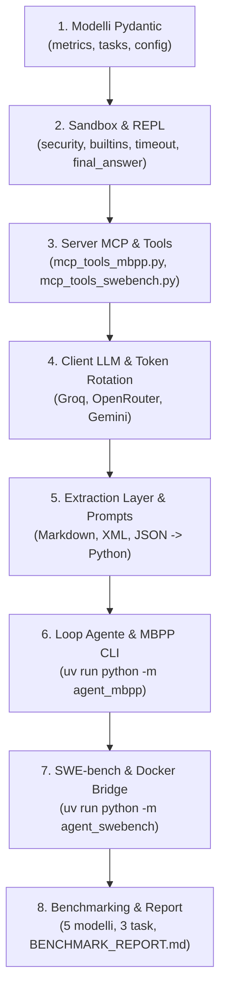

# Agent Smith — Roadmap di Implementazione Passo-Passo

> Guida pratica per gli sviluppatori: come organizzare il repository, configurare l'ambiente e implementare i moduli uno alla volta con ordine.

---

## 1. Struttura del Repository Consigliata

Seguendo le convenzioni standard di Python e quanto richiesto dal subject:

```plaintext
.
├── pyproject.toml              # Dipendenze e metadati gestiti con uv (Python 3.10)
├── README.md                   # Documentazione ufficiale richiesta per la consegna
├── BENCHMARK_REPORT.md         # Report di benchmark su 5 modelli x 3 task SWE-bench
├── makefile                    # Scorciatoie comode per lanciare i test
│
├── mcp_tools_mbpp.py           # Server MCP per MBPP (ALLA RADICE come da subject)
├── mcp_tools_swebench.py       # Server MCP per SWE-bench (ALLA RADICE come da subject)
│
├── config/
│   ├── sandbox_config.json     # Configurazione di default dei limiti del sandbox
│   └── models_config.json      # Elenco provider, modelli ed endpoint
│
├── student/                    # Il core del codice sorgente dell'agente
│   ├── __init__.py
│   ├── models/                 # Schemi Pydantic
│   │   ├── __init__.py
│   │   ├── sandbox.py          # SandboxConfig
│   │   ├── tasks.py            # MBPPTaskInput, SWEBenchTaskInput
│   │   └── metrics.py          # StepMetrics, SolutionOutput
│   ├── sandbox/                # Il Sandbox di esecuzione sicura
│   │   ├── __init__.py
│   │   ├── environment.py      # Esecutore sandboxed, override builtins, timeout
│   │   ├── security.py         # Controllo allowlist import e percorsi file
│   │   └── mcp_client.py       # Client MCP (trasporto stdio e HTTP)
│   ├── agent/                  # Il loop autonomo dell'agente
│   │   ├── __init__.py
│   │   ├── orchestrator.py     # Loop Thought ➔ Code ➔ Observation
│   │   ├── extraction.py       # Parser polimorfo (Markdown, XML, JSON, ReAct)
│   │   ├── prompts.py          # System prompt e generatore manuale sandbox
│   │   └── llm_client.py       # Client HTTP per LLM con rotazione multi-token
│   └── cli/                    # Interfacce a riga di comando
│       ├── __init__.py
│       ├── sandbox_cli.py      # REPL interattivo (uv run sandbox)
│       ├── agent_mbpp.py       # Entrypoint CLI per MBPP
│       └── agent_swebench.py   # Entrypoint CLI per SWE-bench
│
└── docs/                       # Documentazione del team
    ├── GUIDA_PROGETTO.md
    ├── ROADMAP_IMPLEMENTAZIONE.md
    └── SPECIFICHE_TECNICHE_E_TOOLS.md
```

> [!IMPORTANT]
> **Vincolo Python 3.10 e uv**:
> Il subject specifica chiaramente: *"You must use Python 3.10"* e *"You must use uv as your package manager"*.
> Verifica che nel tuo `.python-version` ci sia `3.10` e che `pyproject.toml` abbia `requires-python = ">=3.10,<3.11"`.

---

## 2. Le 8 Fasi di Sviluppo (Milestone)

Costruire tutto insieme può essere disorientante. Procediamo a tappe logiche:



---

### Fase 1: I Modelli Pydantic (`student/models/`)
Definire le strutture dati rigide richieste dal subject prima di scrivere la logica.
- `SandboxConfig`:
  - `authorized_imports`: lista di moduli ammessi (es. `math`, `math.*`, `collections`, `collections.*`, `re`, `json`, `typing`, `typing.*`, ecc.).
  - `allowed_directories`: default `["/testbed", "/tmp/agent"]`.
  - `max_execution_time_seconds`: default `30`.
  - `max_memory_mb`: default `512`.
- `StepMetrics`: traccia per ogni singolo ciclo:
  - `step`, `input_tokens`, `output_tokens`, `request_time_ms`, `timestamp`, `api_url`, `model_name`, `llm_output`, `sandbox_input`, `sandbox_output`, `retries`.
- `SolutionOutput`:
  - `task_id`, `benchmark` ("mbpp" o "swebench"), `success`, `solution`, `iterations`, `total_requests`, `total_input_tokens`, `total_output_tokens`, `total_time_seconds`, `steps`, `system_prompt`, `error`, `timestamp`.
- `MBPPTaskInput`: `task_id`, `task_definition`, `function_definition`, `test_imports`, `test_list`.
- `SWEBenchTaskInput`: `instance_id`, `problem_statement`, `docker_image`, `eval_script`, `hints_text`, `repo`.

---

### Fase 2: Il Sandbox di Sicurezza (`student/sandbox/`)
Il sandbox deve eseguire codice Python generato dall'LLM in modo sicuro.
- **Divieto categorico**: NON usare `RestrictedPython` o librerie magiche simili. Usare solo la libreria standard di Python.
- **Come implementare la sicurezza**:
  1. **Filtraggio Import**: Sovrascrivere `__import__` (o agganciare un custom `sys.meta_path` finder/loader) per consentire solo i moduli che matchano la lista `authorized_imports` (gestendo i pattern `.*`).
  2. **Restrizione Directory**: Intercettare `open` o validare i percorsi passati alle funzioni I/O per verificare che risolvano all'interno di `allowed_directories`.
  3. **Rimozione Builtins Pericolosi**: Rimuovere o bloccare comandi che permettono l'accesso shell diretto o l'introspezione sfrenata se non esplicitamente voluti dal sandbox (es. bloccare `__subclasses__` crawling, limitare `eval`/`exec` non controllati).
  4. **Timeout e Memoria**: Utilizzare `signal.alarm` / `signal.setitimer` (su Linux) oppure un subprocess worker isolato per uccidere l'esecuzione che supera i 30 secondi o eccede la memoria (`resource.setrlimit`).
  5. **Iniezione di `final_answer`**:
     ```python
     class FinalAnswerException(Exception):
         def __init__(self, answer: str):
             self.answer = answer

     def final_answer(answer: str):
         raise FinalAnswerException(str(answer))
     ```
     Iniettando questa funzione nel dizionario di esecuzione globale, chiamare `final_answer(...)` interrompe immediatamente il codice in modo controllato, consegnando l'output!
  6. **Interactive REPL CLI**: Configurare `uv run sandbox` per avviare una shell interattiva che legga comandi ed esegua codice dentro il sandbox.

---

### Fase 3: I Server MCP e i Tool (`mcp_tools_*.py`)
I due server devono stare alla radice del repository:
1. `mcp_tools_mbpp.py`:
   - Espone `run_tests(code, test_list)`: Esegue il codice con i test forniti e restituisce `{"success": bool, "output": str}`.
2. `mcp_tools_swebench.py`:
   - Deve leggere `os.environ.get("TESTBED_PATH", "/testbed")` come cartella radice di lavoro.
   - Espone tutti i tool obbligatori:
     - `read_file(filepath, start_line, end_line)` (output stile `cat -n`).
     - `edit_file(filepath, old_str, new_str)`.
     - `list_files(directory, pattern)`.
     - `search_code(pattern, file_pattern)`.
     - `search_function_or_class_definition_in_code(name)`.
     - `find_references(name, filepath, line)`.
     - `run_tests()`: esegue lo script di evaluation bash dentro il repository.
     - `get_patch()`: esegue `git -c core.fileMode=false diff`.
     - `run_command(command, workdir)`: esegue un comando di shell sicuro restituendo stdout, stderr e exit code.
3. **Integrazione Client nel Sandbox**:
   - Il sandbox avvia il server via `stdio` (es. `python mcp_tools_mbpp.py`) oppure si connette via HTTP.
   - Riceve l'elenco dei tool (schema JSON) e crea dinamicamente funzioni Python callable con la stessa firma, iniettandole nel namespace del sandbox.

---

### Fase 4: Client LLM e Gestione Multi-Token (`student/agent/llm_client.py`)
- **Supporto multi-token e rotazione obbligatoria**:
  - Leggere le chiavi da `.env` o environment (es. `OPENROUTER_API_KEY_1`, `OPENROUTER_API_KEY_2`, ecc.).
  - Se un token riceve un HTTP 429 (Rate Limit) o esaurisce la quota, ruotare automaticamente sulla chiave successiva.
  - Tracciare il numero di tentativi nel campo `retries` di `StepMetrics`.
- **Compatibilità con provider gratuiti**:
  - OpenRouter (`https://openrouter.ai/api/v1`)
  - Groq (`https://api.groq.com/openai/v1`)
  - Google AI Studio / Gemini (`https://generativelanguage.googleapis.com/...`)
- **Uso dei parametri di stop**:
  - Usare `stop: ["<end_code>", "```\n\n", "</tool_call>"]` per evitare che il modello allucini le osservazioni prima che il sandbox risponda.

---

### Fase 5: Extraction Layer e System Prompt (`student/agent/`)
- **System Prompt**:
  - Deve spiegare all'agente chi è, qual è il suo obiettivo, quali tool sono disponibili (generati dinamicamente dal manuale MCP), e il formato di risposta atteso:
    ```
    Thought: spiegazione del ragionamento
    Code:
    ```python
    ... codice ...
    ```
    ```
- **Extraction Layer (`extraction.py`)**:
  - Modelli diversi rispondono con formati diversi:
    1. Blocchi Markdown Python: ```` ```python ... ``` ````.
    2. XML Tool calls: `<invoke name="read_file"><parameter name="filepath">...</parameter></invoke>`.
    3. JSON / Hermes: `<tool_call>{"name": "read_file", "arguments": {...}}</tool_call>`.
    4. ReAct: `Action: read_file\nAction Input: {...}`.
  - Qualsiasi formato deve essere normalizzato in chiamate Python pure (es. `result = read_file(...)`) prima di essere passato al sandbox!
- **Feedback Loop**:
  - Se il codice fallisce o il modello non genera codice, fornire un messaggio di errore chiaro all'LLM (Zero Silent Failures).

---

### Fase 6: Agente MBPP (`student/cli/agent_mbpp.py`)
1. Legge `--task-file` (un file JSON contenente `MBPPTaskInput`).
2. Inizializza il Sandbox collegato a `mcp_tools_mbpp.py`.
3. Inizializza la cronologia con il prompt del task (definizione della funzione e test da passare).
4. Cicla nel loop `Thought ➔ Code ➔ Observation`:
   - L'agente genera il codice della funzione e chiama `run_tests(...)`.
   - Se i test passano, chiama `final_answer(codice_funzione)`.
   - Il loop si interrompe al `final_answer` o al raggiungimento delle 10 iterazioni.
5. Salva il file `--output` con la struttura `SolutionOutput`.

---

### Fase 7: Agente SWE-bench (`student/cli/agent_swebench.py`)
1. Legge `--task-file` (`SWEBenchTaskInput`).
2. Si connette a `mcp_tools_swebench.py` con `TESTBED_PATH` impostato.
3. Il modello esplora il repository (`search_code`, `read_file`), localizza il file con il bug, lo corregge con `edit_file`, esegue i test con `run_tests()`.
4. Quando i test passano, invoca `final_answer(get_patch())`.
5. Raccoglie la patch git e scrive il file di output.
6. **Pulizia container**: Ripristinare o pulire l'ambiente se necessario.

---

### Fase 8: Benchmark Report (`BENCHMARK_REPORT.md`)
Requisiti minimi di valutazione:
- Confronto di **almeno 5 modelli** su **almeno 2 provider**.
- Testati sugli stessi **3 task di SWE-bench** (es. `sympy__sympy-14711`, `sympy__sympy-13480`, `pydata__xarray-4629`).
- Tabelle con: Pass/Fail, iterazioni, token in/out, tempo di esecuzione, retries, latenza.
- Due metriche intermedie (es. a che step legge per la prima volta il file del bug; iterazioni tra test passati e `final_answer`).
- Uno studio di ablazione (es. con o senza un tool specifico, o variazione del prompt).
- Conservare i file `solution.json` generati nella repository come prova.
